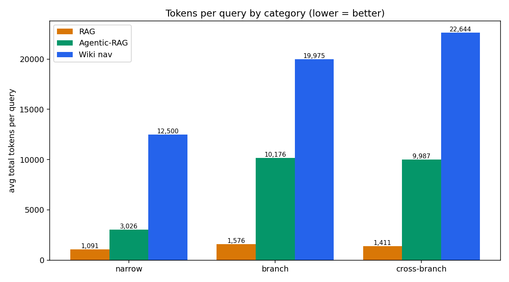
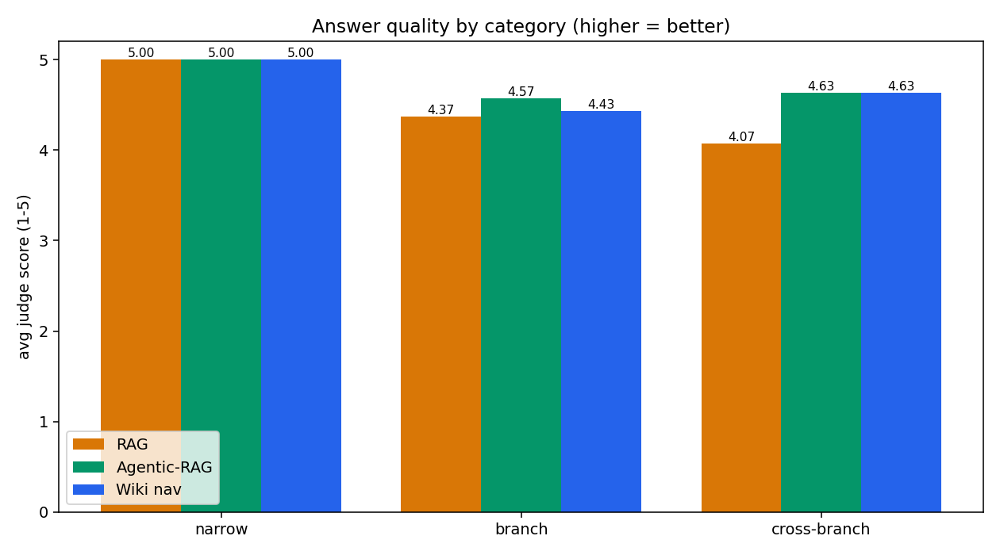
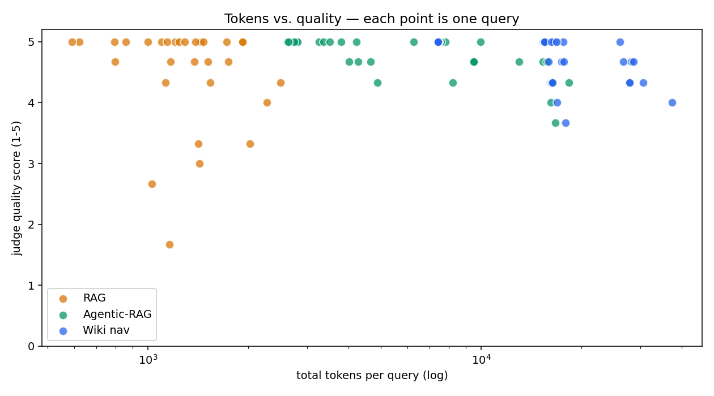
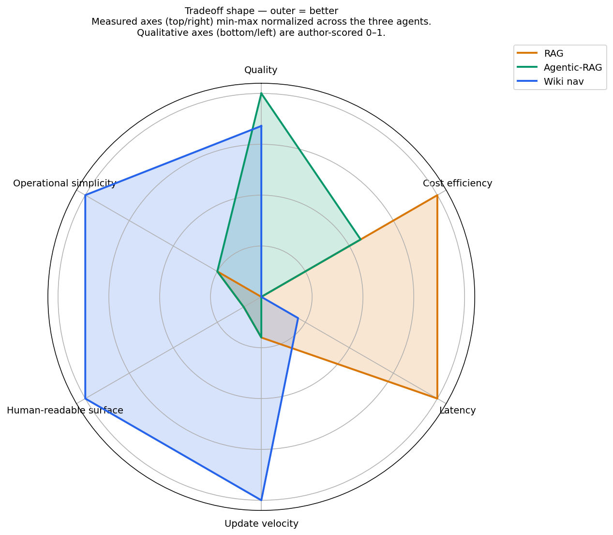
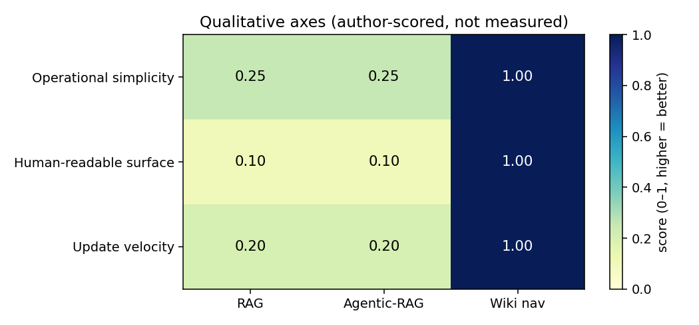

# Wiki-fed agents vs. RAG — a real experiment on the sw30labs wiki

**TL;DR:** The first pass of this experiment compared *single-shot RAG* to a *multi-turn wiki-navigation agent* and concluded that wiki answers were higher quality but far more expensive. That framing was wrong. Adding a third agent — **agentic-RAG**, the same FAISS retrieval as single-shot RAG but wrapped in a multi-turn tool-call loop — closes almost the entire quality gap at **~40 % of wiki's token cost**. Head-to-head, agentic-RAG edges wiki 8–4 (18 ties). The real axis isn't *wiki vs. RAG*; it's **single-shot vs. agentic**. Most of wiki-nav's apparent quality edge came from the turn budget, not from having a sitemap.

This repo is the reproducible source for those numbers.

- **Corpus:** `github.com/sw30labs/.github.wiki` pinned at commit `c130a3b` (89 markdown files, ~45 K corpus tokens)
- **Agent model:** Claude Sonnet 4.6 (temp 0) for all three pipelines
- **Single-shot RAG:** OpenAI `text-embedding-3-small` + FAISS IndexFlatIP, top-k = 5, section-aware chunking (800-token window, 150-token overlap), one Claude call
- **Agentic-RAG:** same FAISS index, wrapped in a ≤8-turn tool-call loop; tools are `retrieve(query, k)` and `read_full_page(path)`
- **Wiki navigation:** precomputed hierarchical sitemap (5 364 tokens) + `read_page(path)` / `list_children(prefix)` tools; ≤8 turns
- **Eval:** 30 synthesized day-to-day queries (10 narrow / 10 branch / 10 cross-branch) with ground-truth source paths
- **Judge:** Claude Opus 4.7 as LLM-judge, absolute 1–5 scoring on relevance + completeness + groundedness

## Results

### Headline numbers

| Metric                   |      RAG | Agentic-RAG | Wiki nav | Agentic vs RAG | Wiki vs RAG |
|--------------------------|---------:|------------:|---------:|---------------:|------------:|
| Avg total tokens / query |    1 359 |       7 730 |   18 373 |         5.7×   |     13.5×   |
| Avg cost / query         | $0.0068  |  $0.0307    | $0.0616  |         4.5×   |      9.1×   |
| Avg latency / query      |   5.0 s  |    13.2 s   |  11.5 s  |         —      |        —    |
| Avg turns                |   1.0    |     2.8     |   2.1    |         —      |        —    |
| Avg quality (1–5)        |   4.48   |     4.73    |   4.69   |     **+0.25**  |    +0.21    |

### Head-to-head (quality wins over 30 queries, ties within ±0.17 on 1–5 scale)

| Pairing                  | A wins | B wins | Ties | Mean Δ (B − A) |
|--------------------------|-------:|-------:|-----:|---------------:|
| RAG  vs  Agentic-RAG     |      5 |   **8**|   17 |     +0.26      |
| RAG  vs  Wiki nav        |      7 |   **9**|   14 |     +0.21      |
| Agentic-RAG  vs  Wiki nav| **8**  |      4 |   18 |     −0.04      |

Agentic-RAG is the only agent on the Pareto frontier: it matches wiki on quality while costing half as much, and it beats single-shot RAG on quality for ~4.5× the per-query cost.

### By query category

| Category     | RAG tokens | Agentic tokens | Wiki tokens | RAG q | Agentic q | Wiki q |
|--------------|-----------:|---------------:|------------:|------:|----------:|-------:|
| narrow       |      1 091 |          3 026 |      12 500 |  5.00 |      5.00 |   5.00 |
| branch       |      1 576 |         10 176 |      19 975 |  4.37 |      4.57 |   4.43 |
| cross-branch |      1 411 |          9 987 |      22 644 |  4.07 |      4.63 |   4.63 |

The quality gap that looked like wiki's win on cross-branch queries (+0.56 over single-shot RAG) is matched exactly by agentic-RAG. Every quality point wiki earned on the hard queries, agentic-RAG also earned — at less than half the tokens.





## Example queries

Two queries from the run, shown as comparative evidence. Full per-query records in `runs/runs.jsonl` and `runs/judgments.jsonl`.

### `q24` — cross-branch, where the gap shows up

> **If I want to build a digital-twin-based incident response simulation, which article frames the concept and which OSCAL repo implements the drift detection?**
>
> Ground truth: `wiki/articles/generative-ai-digital-twins-for-proactive-and.md`, `raw/oscal-digital-twin-playground.stub.md`, `wiki/oscal-compliance/oscal-compliance.md`

| Agent        | Quality | Tokens | Cost    | Notes |
|--------------|--------:|-------:|--------:|-------|
| RAG          |    3.00 |  1 429 | $0.0076 | Missed the article entirely; said "there isn't a dedicated article" and hedged. Top-5 chunks didn't surface it. |
| Agentic-RAG  |    4.67 |  4 267 | $0.0189 | After the first retrieve, refined and got both the article and the repo correctly. |
| Wiki nav     |    5.00 | 16 854 | $0.0568 | Same answer as agentic-RAG; paid 4× the tokens to get there. |

### `q00` — narrow, where all three tie

> **Which tool extracts critical CVEs with network attack vectors from the NVD API?**
>
> Ground truth: `raw/nvd-extractor.stub.md`

| Agent        | Quality | Tokens | Cost    | Notes |
|--------------|--------:|-------:|--------:|-------|
| RAG          |    5.00 |  1 207 | $0.0049 | One call, right answer. |
| Agentic-RAG  |    5.00 |  3 257 | $0.0122 | Same answer, 2 turns. |
| Wiki nav     |    5.00 |  7 451 | $0.0237 | Answered straight from the sitemap summary without opening a page. |

On narrow questions the retrieval substrate barely matters; all three tie and RAG is ~5× cheaper than wiki.

## Scope boundaries (important)

**What this experiment measures:** per-query, day-to-day agent cost and answer quality.

**What it deliberately excludes** (per the brief):
- Building the wiki itself (one-time curator effort)
- Building the RAG index (one-time; logged separately — $0.0009 for this corpus, 9.1 s)

Setup costs are one-offs any production team pays once; they're out of scope for a steady-state comparison.

## What the numbers don't measure

Per-query cost and quality are only part of the picture. Three axes the benchmark ignores but a production decision shouldn't:

- **Operational surface.** Wiki-nav is a sitemap parser plus a two-tool loop — markdown files in git, nothing else underneath. RAG is a chunker, an embedder, a vector store, and a loop, with tuning knobs (chunk size, top-k, embed model) each needing their own evaluation. That's more dependencies, more failure modes (embedding-API outage, vector-store corruption, version skew between embed model and index), and more portability friction when you move providers or self-host. Wiki-nav survives anything `git clone` + an LLM client survives.
- **Dual-surface value.** A wiki is a human-readable product on day one — GitHub renders it, people browse it, contributors open PRs against it. A FAISS index is machine-only; to give humans the same access you build a second product (search UI, chat frontend).
- **Incremental updates.** Wiki update = edit markdown, `git push`, done — the next query sees the new content. RAG update = re-chunk, re-embed, re-upsert into the vector store. Small edits get expensive unless you implement delta-indexing.

Agentic-RAG wins on $/query. It doesn't automatically win when you add the cost of *building* a RAG stack, *maintaining* its index, and *separately* building the human-readable surface the wiki gave you for free.

### Tradeoff shape — the whole picture on one chart



Three measured axes (Quality, Cost efficiency, Latency) min-max normalized across the three agents, and three qualitative axes (Operational simplicity, Human-readable surface, Update velocity) author-scored 0–1. Outer = better on every axis.

Each pipeline's strength lives in a different region of the chart:

- **RAG (orange)** — spike on Cost + Latency, collapsed on the qualitative axes.
- **Agentic-RAG (green)** — spike on Quality, mid-tier on Cost, worst on Latency, collapsed on the qualitative axes.
- **Wiki nav (blue)** — wide coverage of the qualitative half of the chart, moderate Quality, weak Cost + Latency.

Raw values behind the normalized axes: Quality — RAG 4.48, Agentic-RAG 4.73, Wiki 4.69 (spread of 0.25 on a 1–5 scale, so the Quality spike visually exaggerates a small real-world gap). Cost/query — $0.0068 / $0.0307 / $0.0616. Latency — 5.0 s / 13.2 s / 11.5 s.



Close-up of the three qualitative axes. RAG and agentic-RAG score the same on all three because they share the FAISS / embedding substrate; the operational story doesn't change when you wrap RAG in a loop.

## Honest caveats

Adding the agentic-RAG baseline closed the most load-bearing methodological gap (single-shot-vs-agentic confound) but the remaining caveats are real:

- **Evaluation circularity.** Queries were synthesized by Opus *with the sitemap in its context* and ground-truth source paths were produced by the same synthesis call. The sitemap-primed synthesizer plausibly biases toward questions the wiki agent can answer cleanly. This isn't just bias — it's a leak. A follow-up with a sitemap-blind synthesizer would tighten the finding.
- **Statistical rigor.** n = 10 per category, single run, single seed, single judge (Claude judging Claude). No confidence intervals, no bootstrap, no significance tests. The gap between agentic-RAG and single-shot RAG (+0.25) is real; the gap between agentic-RAG and wiki (−0.04) is inside likely-noise. Treat these as directional, not rigorous.
- **Corpus-specific.** The sw30labs wiki is small (45 K tokens) and well-structured. Sprawling, unstructured corpora would likely favor RAG variants further; corpora with rich taxonomy might favor wiki.
- **Implementation-specific.** The RAG stack is vanilla `text-embedding-3-small` + top-k FAISS. No reranker, no hybrid BM25, no query expansion. Most of agentic-RAG's remaining loss to wiki on the hardest queries likely lives here. This experiment does not test those knobs.
- **No failure taxonomy.** Point-estimate quality only; no breakdown of *why* RAG lost the ones it lost (hallucination vs. retrieval miss vs. incomplete citation), no p95 latency, no separate hallucination-rate metric, no cost-per-*correct*-answer.
- **Single model family.** Judge and agents are all Anthropic; Claude-judging-Claude has known intra-family preferences. A second-judge cross-check (e.g., GPT-4 or a human subset) is not included.
- **Operational concerns unmodeled.** Throughput / rate-limit shape, multi-tenant ACL filtering, sitemap maintenance decay, update-latency when pages change — all out of scope.

## What to do with this

If the production decision is RAG-or-wiki for a day-to-day assistant over a wiki-shaped corpus, the finding is: **don't pick wiki for the quality edge alone — wrap RAG in an agentic loop and you get the same quality at half the cost.** Wiki-nav still wins on readability of the trace (sitemap + page reads is easier to explain than embedding hits) and may win on corpora where titles and hierarchy carry most of the signal.

Two natural next experiments:
1. **Hybrid routing.** Wiki picks the subtree, RAG retrieves inside it. Should drop the sitemap cost while preserving agentic-RAG's quality.
2. **Reranker ablation.** Add a Cohere-style cross-encoder reranker on top of agentic-RAG; the cross-branch queries are where this should pay off.

## Reproduction

```bash
# 1. clone
git clone <this-repo>
cd wiki-vs-rag

# 2. install
pip install -r requirements.txt   # openai anthropic faiss-cpu tiktoken pyyaml numpy matplotlib

# 3. set keys
cp .env.example .env  && $EDITOR .env   # fill in OPENAI_API_KEY, ANTHROPIC_API_KEY
source .env

# 4. run everything (~10 min, ~$8 of API spend)
make all
```

Or run phases individually: `make index | make sitemap | make queries | make eval | make judge | make report`.

All raw per-query logs are in `runs/runs.jsonl` and `runs/judgments.jsonl`. Every number above can be recomputed from those files via `report/aggregate.py`.

## Repo layout

```
wiki-vs-rag/
├── README.md                   (this file)
├── Makefile                    (make all / make eval / make report)
├── corpus/                     (wiki pinned at c130a3b)
├── rag/
│   ├── chunker.py              (section-aware markdown chunker)
│   ├── indexer.py              (one-time: embed + build FAISS)
│   └── agent.py                (query-time: embed → top-k → one Claude call)
├── rag_agentic/
│   └── agent.py                (query-time: Claude + retrieve/read_full_page tools, ≤8 turns)
├── wiki/
│   ├── sitemap.py              (one-time: build hierarchical map)
│   └── agent.py                (query-time: Claude + read_page/list_children tools, ≤8 turns)
├── eval/
│   ├── synthesize.py           (Opus 4.7 generates 30 queries + ground truths)
│   ├── run.py                  (runs all three pipelines over the query set)
│   ├── judge.py                (Opus 4.7 judge, absolute 1-5 scoring)
│   └── queries.jsonl           (the 30 queries — committed for reproducibility)
├── runs/                       (raw per-query logs)
│   ├── runs.jsonl
│   └── judgments.jsonl
└── report/
    ├── summary.json            (aggregate stats)
    ├── results.csv             (row per (query, agent))
    └── *.png                   (charts)
```

## Cost of running this experiment

| Phase                                | Cost       |
|--------------------------------------|-----------:|
| RAG index build (one-time)           | $0.0009    |
| Sitemap build (no LLM)               | $0.0000    |
| Query synthesis (Opus 4.7 × 30)      | $1.35      |
| Eval runs — RAG (Sonnet × 30)        | $0.20      |
| Eval runs — Agentic-RAG (Sonnet × 30)| $0.92      |
| Eval runs — Wiki (Sonnet × 30)       | $1.85      |
| Judge (Opus 4.7 × 90)                | $3.98      |
| **Total**                            | **~$8.30** |

## Author

Nicolas Cravino · [sw30labs](https://github.com/sw30labs) · 2026-04-18
